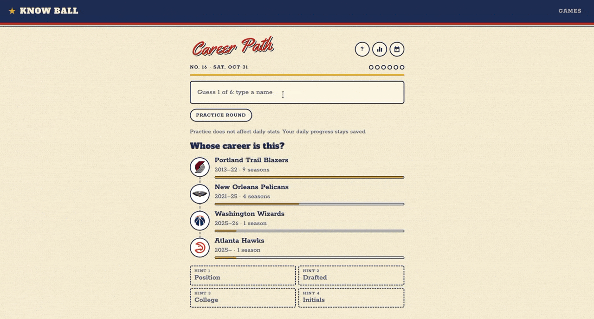
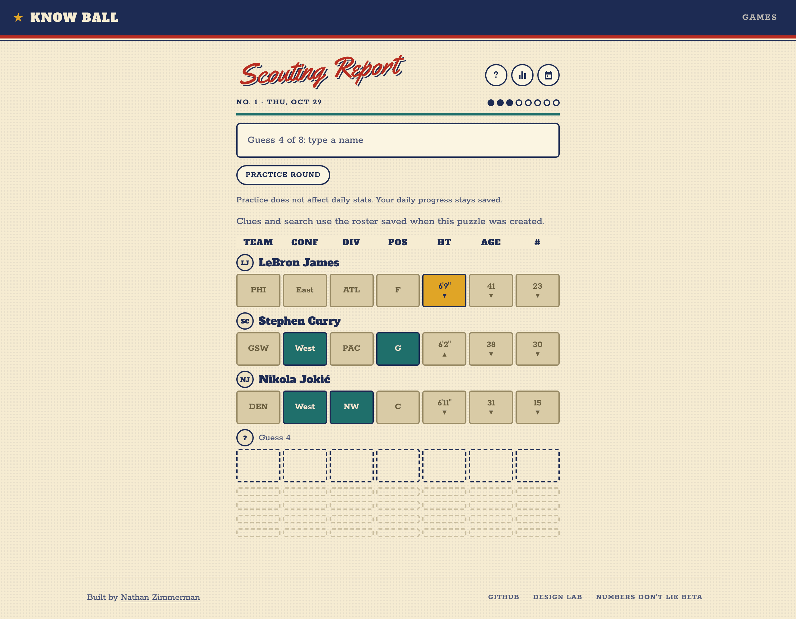
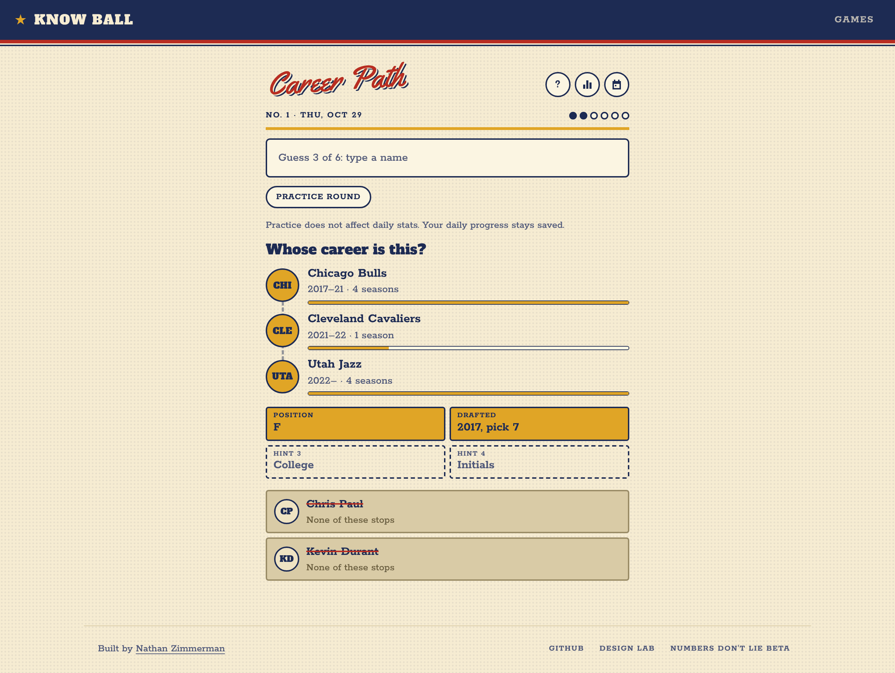
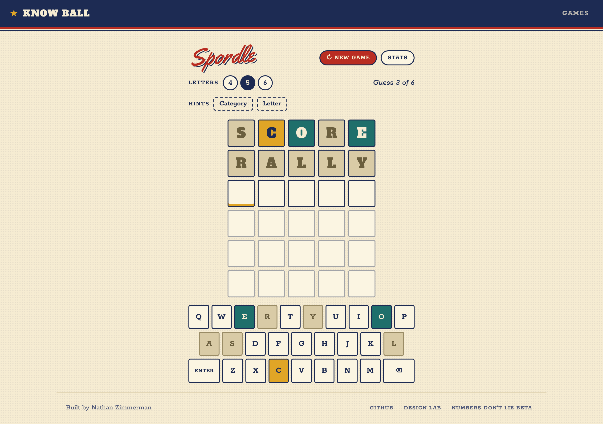
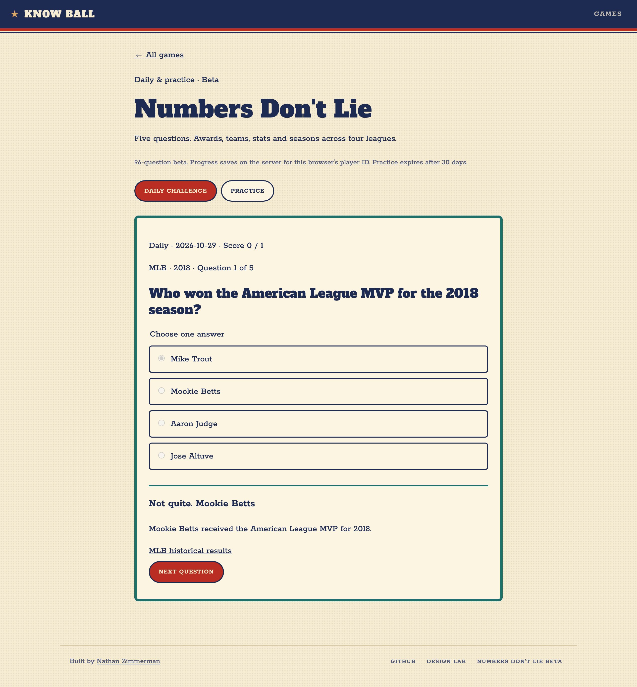
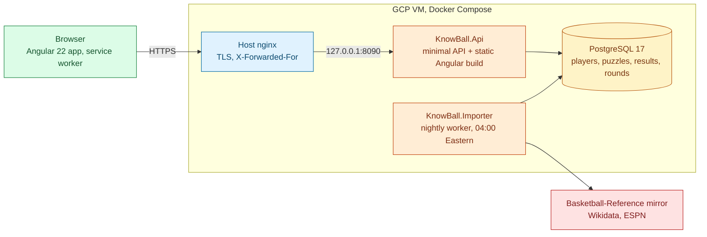

# Know Ball

Daily sports trivia: a word game, two guess-the-player games and a stats quiz, with a new puzzle every day at
midnight Eastern. Angular front end, ASP.NET Core API and PostgreSQL, fed by a nightly import of every NBA player
since 1947.

[](https://github.com/natezimm/know-ball/actions/workflows/ci.yml)
[](LICENSE)
[](https://knowball.nathanzimmerman.com)



**Play it at [knowball.nathanzimmerman.com](https://knowball.nathanzimmerman.com).** No sign-up; your progress
stays with your browser.

| Scouting Report | Career Path |
| --- | --- |
|  |  |
| **Spordle** | **Numbers Don't Lie** |
|  |  |

## What it does

- **Spordle**: find a sports word of 4, 5 or 6 letters in six tries, with category and letter hints.
- **Scouting Report**: guess today's NBA player in eight tries; each guess is graded on team, conference,
  division, position, height, age and jersey number.
- **Career Path**: name the player from every team they played for, in order; each miss unlocks a hint.
- **Numbers Don't Lie** (beta): five multiple-choice questions on stats, awards, champions and seasons across the
  NBA, NFL, MLB and NHL, with an explanation and source for every answer.
- Practice rounds, an archive of past dailies, stats and streaks per game, and a spoiler-free share card.
- Installable as a phone app (PWA), and built for phones first.

## Engineering highlights

- **Answers never leave the server early.** Each puzzle keeps its public payload apart from its secret, guesses
  are graded on the server, and the answer is attached only once the game is won or lost
  ([ADR 0002](docs/adr/0002-answers-stay-on-the-server.md), [`GameService`](src/KnowBall.Application/Games/GameService.cs)).
- **Retries never cost a guess.** Guesses carry a client `requestId` and are saved with a compare-and-swap, so a
  dropped response or two open tabs cannot spend or lose a guess, with no schema change
  ([ADR 0004](docs/adr/0004-idempotent-guesses.md)).
- **A defensive nightly import.** Changes land in one save, imports are repeatable (CI runs them twice and expects
  nothing to change), and a feed that suddenly returns under half the league fails the run instead of retiring
  everyone. A nightly canary runs the live sources against a throwaway database
  ([ADR 0005](docs/adr/0005-defensive-nightly-import.md), [`PlayerImportService`](src/KnowBall.Application/Import/PlayerImportService.cs)).
- **Clean layers, two databases.** Domain, Application, Infrastructure and two thin hosts share one engine; games
  plug in through `IGame`. Tests run the same code on SQLite and PostgreSQL
  ([ADR 0001](docs/adr/0001-layered-backend.md)).
- **Abuse limits that hold behind a proxy.** Every request is rate limited per address, with stricter limits on
  guesses, IPv6 counted by /64, and `X-Forwarded-For` trusted only from known proxies
  ([`RateLimits`](src/KnowBall.Api/Endpoints/RateLimits.cs)).

## Architecture



One process serves the API and the Angular build; the importer is the same image with another entry point.
[docs/architecture.md](docs/architecture.md) has the system context, the project layering, the daily puzzle and
guess sequence, and the delivery pipeline. Design decisions are recorded in [docs/adr](docs/adr/README.md).

## Tech stack

| Area | Choices |
| --- | --- |
| Front end | Angular 22 (standalone, zoneless, signals), service worker, Vitest |
| API | ASP.NET Core minimal APIs on .NET 10, built-in rate limiting, health checks |
| Data | EF Core with PostgreSQL 17 (migrations) and SQLite (tests and quick local runs) |
| Import | Hosted worker, Basketball-Reference CSV mirror, Wikidata SPARQL, ESPN roster feed |
| Testing | xUnit, `FakeTimeProvider`, Playwright, Docker smoke test |
| Delivery | GitHub Actions, GitHub Container Registry, Docker Compose on a GCP VM, nginx, Let's Encrypt |

## Run it locally

With Docker, the whole site on http://localhost:8080 (the importer loads the live player data on first start,
which takes about a minute):

```bash
docker compose --profile site up -d --build
```

From source, with .NET 10 and Node 24:

```bash
docker compose up -d db                                # Postgres on :5432 (KNOWBALL_DB_PORT to change)
dotnet run --project src/KnowBall.Importer -- --once   # full history, then today's rosters
dotnet run --project src/KnowBall.Api                  # http://localhost:5080
cd web/know-ball && npm install && npm start           # http://localhost:4200
```

No Docker? Set `Database__Provider=Sqlite ConnectionStrings__Trivia="Data Source=$PWD/artifacts/trivia-dev.db"`
for both the importer and the API. Add `--source seed --no-history` to the importer to load a bundled sample of
players without the network. Importer options are in [docs/importer.md](docs/importer.md) and endpoints in
[docs/api.md](docs/api.md).

## Tests and quality

```bash
dotnet test tests/KnowBall.UnitTests
dotnet test tests/KnowBall.IntegrationTests      # SQLite; set TRIVIA_TEST_POSTGRES to a connection string for Postgres
cd web/know-ball && npm test
cd web/know-ball && npm run e2e                  # Playwright plays every game against the real API
```

CI runs on every pull request: the .NET build with unit tests and integration tests on both SQLite and Postgres,
an importer repeatability check, the Angular specs and production build, Playwright end-to-end tests that win and
lose each game against the real API, and a Docker job that smoke-tests the production image and rehearses a
backup and restore. `./scripts/verify.sh` runs all of it locally.

## Deployment

Every push to `main` that passes CI publishes the image to GitHub Container Registry, and the deploy job has the
VM pull that commit's image, restart with Docker Compose and pass a health check. Postgres and the importer run
beside the site and are not reachable from outside. Setup, backups and recovery are in
[deploy/README.md](deploy/README.md).

## Project layout

```
src/
  KnowBall.Domain/            entities: League, Team, Player, PlayerTeamStint, Puzzle, UserResult...
  KnowBall.Application/       Games/ (engine and one folder per game), Import/, Numbers/, Players/
  KnowBall.Infrastructure/    EF Core context and migrations, data source clients, bundled data
  KnowBall.Api/               minimal API endpoints; serves the Angular build from wwwroot
  KnowBall.Importer/          nightly worker and CLI
tests/
  KnowBall.UnitTests/         engine, games, importers, parsers (fixture CSVs in tests/fixtures)
  KnowBall.IntegrationTests/  the API over HTTP on SQLite or Postgres
web/know-ball/                Angular app: core/, shared/, games/, pages/; e2e/ for Playwright
deploy/                       production compose file, nginx site, operations tooling
docs/                         architecture, ADRs, API and importer reference, archive/
```

## Roadmap

- **Numbers Don't Lie** is a beta with 96 questions. Next: a larger reviewed question bank on the approved-content
  queue that is already built, and stats, streaks and an archive like the other games
  ([current scope](docs/numbers-dont-lie/README.md)).
- **A daily Spordle** on the shared engine, keeping today's open-ended rounds as practice.
- **More games** shown as "On deck" on the home page: Geo Sports, Sportle, Sound It Out and Who's the GOAT?
- **Accounts**, by linking an account to a browser's anonymous id, so progress can follow a player across devices.

## Data and images

Player data comes from the Basketball-Reference mirror, Wikidata and ESPN's public feed; headshots and logos are
the NBA's, linked from its CDN and never stored. That is fine for a personal project and would need revisiting for
anything commercial. Details in [docs/research.md](docs/research.md).

## License

The code is MIT-licensed; see [LICENSE](LICENSE). It does not cover the player data, headshots or logos the site
loads from the sources above, which belong to their owners.
