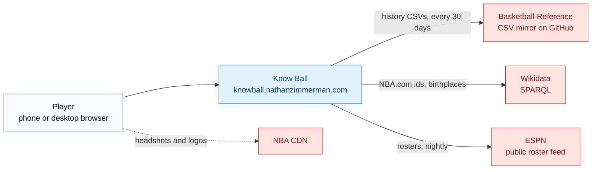
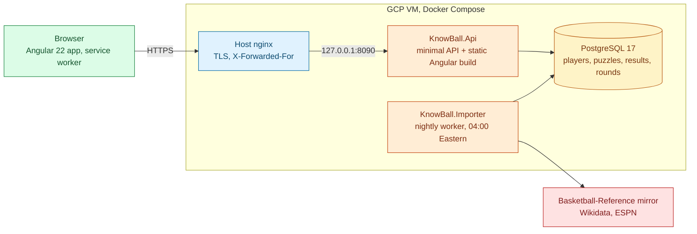
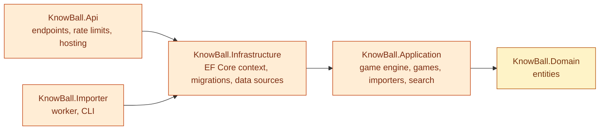
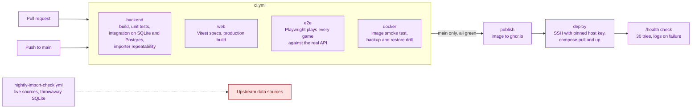

# Architecture

Know Ball is one ASP.NET Core process that serves both the JSON API and the built Angular app, a worker process
that imports player data and queues puzzles, and a PostgreSQL database they share. All three run from one Docker
image on a GCP VM behind nginx.

The diagrams use the same colour key across all of Nathan's repositories: grey for people, blue for the site,
green for client code, orange for server code, amber for data, purple for delivery and red for outside services.

## 1. System context

Who uses Know Ball and what it depends on.



Only the importer talks to the data sources. Players' browsers load headshots and team logos straight from the
NBA's CDN; the site never proxies or stores them.

## 2. Containers and runtime

The processes on the VM and what calls what.



- **Browser.** A standalone, zoneless Angular app. It makes up an anonymous player id on the first visit and
  sends it as `X-Anon-Id` on every API call (`core/anon-id.ts`). The service worker caches the app shell only;
  gameplay always goes to the API.
- **API.** Applies EF Core migrations on start, rate limits every request per address, and serves the Angular
  build from `wwwroot` with a fallback to `index.html` for client routes. Endpoints are listed in [api.md](api.md).
- **Importer.** The same image with a different entry point. It reloads the history every 30 days, loads rosters
  nightly and keeps 30 days of daily puzzles queued ahead. See [importer.md](importer.md).
- **Database.** PostgreSQL in production. Tests and quick local runs use SQLite through the same EF Core model.

### Source boundaries

The backend is five projects with dependencies pointing inward:



- `KnowBall.Domain` holds plain entities (`League`, `Team`, `Player`, `PlayerTeamStint`, `Puzzle`, `UserResult`,
  `SpordleSession`, `NumbersPlay` and others) with no dependencies.
- `KnowBall.Application` holds the rules: `GameService` and `PuzzleScheduler` (the shared daily-game engine),
  one folder per game, the import services and player matching. It reaches the database only through
  `ITriviaDb`, a narrow slice of the EF Core context, and the data sources through interfaces such as
  `IHistorySource` and `ICrosswalkSource`.
- `KnowBall.Infrastructure` implements those: `TriviaDbContext` for Postgres or SQLite, the CSV, Wikidata and ESPN
  clients, and the bundled seed data. Numbers Don't Lie's play service lives here too, because it works directly
  on its JSON snapshots through the context.
- `KnowBall.Api` and `KnowBall.Importer` are thin hosts that wire the layers together.

A daily game plugs into the engine by implementing `IGame` (`Games/GameModels.cs`): generate a puzzle, evaluate
a guess, unlock clues after misses and reveal the answer. Scouting Report and Career Path are the two
implementations; Spordle and Numbers Don't Lie have their own services because their rounds are not
"guess the player".

## 3. Signature sequence: a daily puzzle and a guess

The flow that carries most of the design: the puzzle is made once per Eastern day, the answer stays on the
server until the game is over, and a retried guess never costs a second try.

```mermaid
sequenceDiagram
  autonumber
  actor P as Player
  participant W as Angular app
  participant A as API (GameService)
  participant S as PuzzleScheduler
  participant D as PostgreSQL

  P->>W: Open /scouting-report
  W->>A: GET /api/scouting-report/daily (X-Anon-Id)
  A->>S: GetOrCreateDailyAsync(game, today in Eastern time)
  S->>D: Find today's puzzle
  alt queued by the importer
    D-->>S: Puzzle (payload + secret)
  else none yet
    S->>D: Insert a generated puzzle (unique game, league, date)
    Note over S,D: If another request inserted it first,<br/>the unique index rejects this one and both use theirs.
  end
  A-->>W: Payload, clues and saved guesses, no answer
  P->>W: Pick a player from the guess box
  W->>A: POST /api/scouting-report/{id}/guess {playerId, requestId}
  A->>D: Read this player's result
  alt requestId already recorded
    A-->>W: The original result, no guess spent
  else new guess
    A->>A: Evaluate against the secret (team, conference, division, position, height, age, number)
    A->>D: Update only if the stored guesses are unchanged (compare-and-swap)
    Note over A,D: A concurrent guess from another tab makes the<br/>update miss, and the guess is evaluated again.
    A-->>W: Feedback; the answer only if won or out of guesses
  end
```

Each `Puzzle` row keeps what players may see (`PayloadJson`) apart from what they may not (`SecretJson`), so an
endpoint cannot leak the answer by serializing the wrong field. Players already used as an answer are kept out
of the same game for 120 days (`PuzzleScheduler.NoRepeatDays`), and daily puzzles favour well-known players by a
popularity score computed at import.

## 4. Delivery pipeline



The VM never builds anything: it pulls the image tagged with the commit and restarts. A manual
`production-operations.yml` workflow audits the server, takes a backup and restores it into a disposable
database. Setup and recovery steps are in [deploy/README.md](../deploy/README.md).
